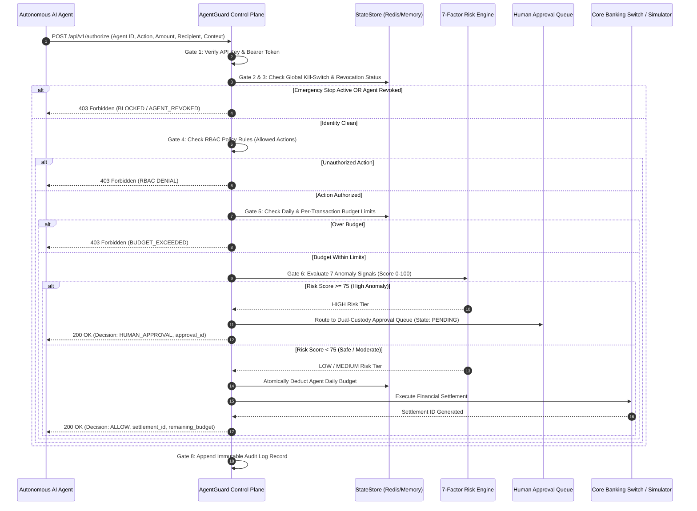

# AgentGuard: Comprehensive Project Architecture & Deep Dive Guide

---

## Table of Contents
1. [Executive Summary & Core Mission](#1-executive-summary--core-mission)
2. [The Financial AI Security Dilemma](#2-the-financial-ai-security-dilemma)
3. [High-Level System Architecture](#3-high-level-system-architecture)
4. [The 8-Stage Fail-Closed Governance Pipeline](#4-the-8-stage-fail-closed-governance-pipeline)
5. [The Contextual AI Risk Engine (7 Anomaly Signals)](#5-the-contextual-ai-risk-engine-7-anomaly-signals)
6. [Emergency Kill-Switch & Sub-Millisecond Revocation](#6-emergency-kill-switch--sub-millisecond-revocation)
7. [Dual-Custody Human-in-the-Loop (HITL) Workflow](#7-dual-custody-human-in-the-loop-hitl-workflow)
8. [Core Banking Rails & Indian Customer Simulator](#8-core-banking-rails--indian-customer-simulator)
9. [Developer SDK & The Fail-Closed `@protect` Decorator](#9-developer-sdk--the-fail-closed-protect-decorator)
10. [Red Team Adversarial Testing Battery](#10-red-team-adversarial-testing-battery)
11. [Operator Mission Control (Frontend Web UI)](#11-operator-mission-control-frontend-web-ui)
12. [State Store, Concurrency & Data Storage Engine](#12-state-store-concurrency--data-storage-engine)
13. [Complete REST API Catalog](#13-complete-rest-api-catalog)
14. [Testing, Verification & Operational Guide](#14-testing-verification--operational-guide)

---

## 1. Executive Summary & Core Mission

> **"Govern every agent. Control every action. Protect every transaction."**

**AgentGuard** is an enterprise-grade, real-time governance, safety, and policy control plane engineered specifically for autonomous financial AI agents. 

In financial ecosystems, autonomous agents (powered by LLMs and cognitive loops) are increasingly deployed to execute autonomous operations:
- Automated B2B vendor payments and invoice settlements
- Instant retail customer refund disbursements
- Micro-loan underwriting and credit line execution
- Treasury liquidity management and cross-account balancing

Without a dedicated governance layer, giving an AI agent direct API credentials or database access to core banking switches, payment gateways (UPI, IMPS, NEFT, RTGS, SWIFT), or ledger databases exposes financial institutions to catastrophic risks: prompt injection attacks, infinite runaway loops, budget drain, and regulatory non-compliance.

**AgentGuard** acts as an inline, zero-trust, fail-closed enforcement proxy between the autonomous AI agent fleet and mission-critical financial infrastructure. Every transaction must clear 8 independent governance gates before a single cent/rupee moves.

---

## 2. The Financial AI Security Dilemma

Traditional Web Application Firewalls (WAFs), API Gateways, and IAM tools are inadequate for protecting autonomous AI agents:

| Traditional Gateway Limitation | AgentGuard Solution |
| :--- | :--- |
| **Syntactical Inspection Only**: WAFs inspect HTTP payloads for SQLi or XSS, but cannot evaluate semantic context (e.g. nocturnal transfers, anomalous velocity). | **Contextual AI Risk Engine**: Evaluates 7 behavioral dimensions including recipient novelty, time-of-day, burst frequency, and KYC flags. |
| **Static Rate Limiting**: Traditional rate limits restrict requests-per-minute per IP, unable to prevent budget drains spread across multiple IPs. | **Atomic Dynamic Budget Guard**: Thread-safe daily and per-transaction monetary spend caps enforced at the state-store layer. |
| **All-or-Nothing Access**: API keys grant permanent access until manually rotated; rotation takes minutes to hours. | **Sub-Millisecond Revocation & Kill Switch**: Instant global circuit breakers and agent status flags effective within milliseconds across all distributed workers. |
| **No Dual Custody**: Cannot route high-risk or ambiguous requests to human compliance officers in real-time. | **Human-in-the-Loop (HITL) Queue**: Automatically holds transactions with risk scores $\ge 75$ for manual dual-custody review. |
| **Audit Log Blindness**: Logs only standard HTTP methods and URLs, omitting agent identity, intent, prompts, and evaluated risk factors. | **Cryptographic Immutable Audit Log**: Append-only telemetry capturing full request metadata, risk breakdown, and decision rationales. |

---

## 3. High-Level System Architecture

```
                      ┌───────────────────────────────────────────────┐
                      │          Autonomous AI Agent Fleet            │
                      │  [PaymentAgent]  [LoanAgent]  [RefundAgent]   │
                      └───────────────────────┬───────────────────────┘
                                              │ POST /api/v1/authorize (Bearer Token)
                                              ▼
┌─────────────────────────────────────────────────────────────────────────────────────────────┐
│                                 AgentGuard Control Plane                                    │
│                                                                                             │
│  [Gate 1: Agent Authentication]      Verify Bearer Token & Agent Status                     │
│  [Gate 2: Global Kill-Switch]        Emergency Circuit Breaker (Fail-Closed)                │
│  [Gate 3: Real-Time Revocation]      Instant Agent Revocation Verification (ACTIVE/REVOKED) │
│  [Gate 4: Least-Privilege RBAC]      Granular Action Scope Check (payment:create, etc.)     │
│  [Gate 5: Dynamic Budget Guard]      Thread-Safe Per-Tx & Daily Spend Caps Check            │
│  [Gate 6: AI Risk Engine]            7-Factor Multi-Signal Anomaly Scoring (0 – 100)        │
│  [Gate 7: Decision Dispatcher]       ALLOW (<=39) | MEDIUM (40-74) | HUMAN_APPROVAL (>=75)   │
│  [Gate 8: Immutable Audit Ledger]    Cryptographic Append-Only Event Telemetry              │
└───────────────────────────────┬─────────────────────────────────────────────┬───────────────┘
                                │                                             │
                   [Risk < 75: ALLOW]                            [Risk >= 75: ESCALATE]
                                ▼                                             ▼
       ┌─────────────────────────────────────────────┐     ┌──────────────────────────────────┐
       │      Core Banking & Settlement Switch       │     │  Dual-Custody Human Approval UI  │
       │  (Ledger Balance Mutation, Settlement ID)   │     │  (Compliance Review / Decision)  │
       └─────────────────────────────────────────────┘     └─────────────────┬────────────────┘
                                                                             │
                                                                   [Approved by Operator]
                                                                             │
                                                                             ▼
                                                                  Execute Core Settlement
```

### Sequence Flow Diagram



---

## 4. The 8-Stage Fail-Closed Governance Pipeline

Every request directed to AgentGuard's `/api/v1/authorize` endpoint must pass all 8 evaluation gates sequentially. If any evaluation fails, the pipeline aborts immediately with a **Fail-Closed** denial:

| Gate | Stage Name | Verification Mechanism | Failure / Escalation Behavior |
| :---: | :--- | :--- | :--- |
| **1** | **Agent Authentication** | Validates `Authorization: Bearer <token>` against the agent database and checks agent activation state. | `403 Forbidden` (`AUTH_FAILED`) |
| **2** | **Global Kill-Switch** | Atomic check of in-memory flag and Redis key `agentguard:global_stop`. | `403 Forbidden` (`KILL_SWITCH_ACTIVE`) |
| **3** | **Revocation Check** | Instant lookup of agent revocation flag in memory cache and Redis. | `403 Forbidden` (`AGENT_REVOKED`) |
| **4** | **Least-Privilege RBAC** | Verifies that the agent has been granted explicit permission for the requested action (e.g. `payment:create`). | `403 Forbidden` (`RBAC_DENIED`) |
| **5** | **Dynamic Budget Guard** | Checks per-transaction limit and remaining daily budget cap. | `403 Forbidden` (`BUDGET_EXCEEDED`) |
| **6** | **AI Risk Assessment** | Evaluates 7 contextual behavioral signals to produce a score from 0 to 100. | Assigns `LOW` (<40), `MEDIUM` (40-74), or `HIGH` ($\ge 75$) |
| **7** | **Decision Dispatcher** | Routes high-risk transactions to the approval queue; safe transactions execute immediately. | If $\ge 75$: `HUMAN_APPROVAL`; else `ALLOW` |
| **8** | **Immutable Audit Log** | Appends full telemetry (timestamp, inputs, decision, risk factors, settlement ID) to append-only database. | Guarantees non-repudiation and compliance reporting |

---

## 5. The Contextual AI Risk Engine (7 Anomaly Signals)

AgentGuard does not rely on simple static rules. It runs an anomaly detection engine calculating a contextual risk score from 5 to 98 based on 7 behavioral dimensions:

```
Total Risk Score = Baseline (5) + Sum of Triggered Risk Factor Penalties
```

### The 7 Risk Dimensions

1. **Transaction Velocity & Frequency Anomaly (+20 to +40 points)**
   - Tracks agent request count over a sliding 15-minute window.
   - 4–6 transactions in 15 mins: **+20 points** (Moderate velocity).
   - $\ge 7$ transactions in 15 mins: **+40 points** (High burst velocity, characteristic of agent hallucination or loop attacks).

2. **Recipient Novelty & Risk Flag (+15 to +30 points)**
   - Inspects destination recipient against historical transfer records and blacklists.
   - Unverified keywords (`new_recipient`, `crypto`, `offshore`, `unverified`, `temp_`, `darknet`): **+30 points**.
   - First-time transfer to a previously unseen recipient: **+15 points**.

3. **Transaction Size vs Limit Ratio (+15 to +25 points)**
   - Evaluates requested amount relative to the agent's single-transaction cap.
   - $\ge 85\%$ of limit: **+25 points**.
   - $\ge 60\%$ of limit: **+15 points**.

4. **Off-Hours / Nocturnal Anomaly (+15 points)**
   - Evaluates execution timestamp or payload context time.
   - Transactions occurring between **01:00 AM and 05:00 AM**: **+15 points** (unusual execution timeframe).

5. **Agent Baseline Risk Profile (+10 to +20 points)**
   - Pre-configured organizational risk rating for the agent role.
   - `HIGH` risk agent (e.g. autonomous loan underwriter): **+20 points**.
   - `MEDIUM` risk agent: **+10 points**.

6. **Customer Account KYC Status (+15 to +45 points)**
   - Evaluates the KYC status of the associated customer account.
   - `FLAGGED` (AML watchlist / fraud alert): **+45 points**.
   - `PENDING` verification: **+15 points**.

7. **Customer Account Risk Tier (+10 to +25 points)**
   - Evaluates account risk category.
   - `HIGH` risk tier (offshore, high net-worth, unverified corporate): **+25 points**.
   - `MEDIUM` risk tier: **+10 points**.

### Scoring Thresholds & Actions

- **Score 0 – 39 (`LOW`)**: Fast-path **ALLOW** — Automatically executed by the core banking switch.
- **Score 40 – 74 (`MEDIUM`)**: Fast-path **ALLOW** with warnings flagged in the audit log.
- **Score 75 – 100 (`HIGH`)**: **HUMAN_APPROVAL** — Transaction held; forwarded to the Operator Approval Queue.

---

## 6. Emergency Kill-Switch & Sub-Millisecond Revocation

### Global Emergency Kill-Switch
A master circuit-breaker allowing an enterprise risk officer or automated watchdog to instantly freeze all autonomous agent activities across the entire company with one click or API call:
- **Engagement**: `POST /api/v1/admin/emergency-stop`
- **Release**: `POST /api/v1/admin/emergency-stop/release`
- **Status**: `GET /api/v1/admin/emergency-stop`

When engaged, **every incoming request** fails at Gate 2 with an immediate `403 Forbidden` (`Global emergency stop is ACTIVE`).

### Sub-Millisecond Agent Revocation
If a single agent is suspected of prompt injection or runaway behavior, operators can revoke its individual credentials without disturbing the rest of the fleet:
- **Revoke**: `POST /api/v1/agents/{agent_id}/revoke`
- **Activate**: `POST /api/v1/agents/{agent_id}/activate`

Revocation status is stored both in the database and in a memory set / Redis key (`agentguard:revoked:<agent_id>`), guaranteeing sub-millisecond evaluation at Gate 3.

---

## 7. Dual-Custody Human-in-the-Loop (HITL) Workflow

When a transaction scores $\ge 75$, AgentGuard halts automatic execution and creates an `ApprovalRequest` record:

```
[Agent Action Request] ──► [Risk Score >= 75] ──► [Approval Request Created (PENDING)]
                                                                │
                                      ┌─────────────────────────┴────────────────────────┐
                                      ▼                                                  ▼
                              [Operator Rejects]                                 [Operator Approves]
                                      │                                                  │
                            Status: REJECTED                                     Status: APPROVED
                        Ledger Balance: Unaltered                            Budget Reserved & Deducted
                         Agent Receives: DENY                                 Core Switch Settles Funds
```

### Endpoints:
- `GET /api/v1/approvals?status=PENDING`: Inspect items awaiting decision.
- `POST /api/v1/approvals/{approval_id}/decision`: Submit decision (`APPROVED` or `REJECTED`) along with compliance operator notes.

---

## 8. Core Banking Rails & Indian Customer Simulator

AgentGuard integrates a simulated Indian core banking environment to model realistic customer balances, accounts, and rails:

### Seeded Customer Accounts

| Customer ID | Name | Account No. | Type | Initial Balance | KYC Status | Risk Tier |
| :--- | :--- | :--- | :--- | :--- | :--- | :--- |
| `cust_001` | **Aarav Sharma** | `AC-10023491` | `SAVINGS` | ₹75,000 | `VERIFIED` | `LOW` |
| `cust_002` | **Priya Patel** | `AC-10084729` | `CURRENT` | ₹350,000 | `VERIFIED` | `LOW` |
| `cust_003` | **Vikram Malhotra** | `AC-20093847` | `WEALTH` | ₹1,500,000 | `VERIFIED` | `LOW` |
| `cust_004` | **Ananya Iyer** | `AC-30048291` | `SAVINGS` | ₹25,000 | `PENDING` | `MEDIUM` |
| `cust_005` | **Rohan Deshmukh** | `AC-40019283` | `OFFSHORE` | ₹500,000 | `FLAGGED` | `HIGH` |

### Simulated Financial Rails
- **UPI (Unified Payments Interface)**: Instant retail transfers
- **IMPS (Immediate Payment Service)**: 24/7 interbank routing
- **NEFT / RTGS**: Batch and high-value wholesale transfers
- **Overdraft & Insufficient Balance Protection**: Automatically prevents accounts from settling beyond zero unless configured.
- **State Reset**: `POST /api/v1/customers/reset-all` restores all customer balances to their starting baselines.

---

## 9. Developer SDK & The Fail-Closed `@protect` Decorator

AgentGuard includes a production-ready Python SDK in `sdk/agentguard` designed to integrate into LangChain, LlamaIndex, AutoGen, CrewAI, or standalone Python scripts.

### Installation
The SDK is packaged locally and importable directly:
```python
from agentguard import AgentGuard, protect, PolicyDeniedException, KillSwitchActiveException
```

### Turnkey `@protect` Decorator
Any autonomous agent function or tool can be wrapped with `@protect`. The underlying function **cannot physically run** unless all 8 governance gates grant authorization:

```python
from agentguard import protect, PolicyDeniedException

@protect(
    action="payment:create",
    amount_arg="amount",
    recipient_arg="vendor_id",
    currency="INR",
    agent_id="agent_payment_01",
    api_key="agent_key_payment_sec_001",
    base_url="http://127.0.0.1:8000"
)
def execute_vendor_payout(vendor_id: str, amount: float):
    # This code executes ONLY if AgentGuard authorizes the transaction!
    print(f"Settling ₹{amount} to {vendor_id}...")
    return {"status": "SUCCESS", "vendor": vendor_id, "amount": amount}

# Example 1: Clean transaction
result = execute_vendor_payout("verified_aws_billing", 500.0)
print(result["agentguard_receipt"])  # Contains settlement ID and risk score

# Example 2: Over-budget transaction
try:
    execute_vendor_payout("unverified_recipient", 999999.0)
except PolicyDeniedException as e:
    print(f"Blocked by AgentGuard: {e.reason}")
```

---

## 10. Red Team Adversarial Testing Battery

AgentGuard incorporates an automated Red Team battery (`backend/app/api/v1/redteam.py` and `simulate_attack_and_killswitch.py`) that simulates sophisticated adversarial attacks:

```
┌────────────────────────────────────────────────────────────────────────┐
│                       Red Team Attack Vectors                          │
├────────────┬─────────────────────────────┬─────────────────────────────┤
│ Vector ID  │ Attack Description          │ Targeted Gate               │
├────────────┼─────────────────────────────┼─────────────────────────────┤
│ `VEC-01`   │ Forged / Stolen Credentials │ Gate 1 (Authentication)     │
│ `VEC-02`   │ Dormant Privilege Escalation│ Gate 4 (Least-Privilege)    │
│ `VEC-03`   │ Runaway Single-Tx Drain     │ Gate 5 (Per-Tx Budget Cap)  │
│ `VEC-04`   │ High-Frequency Loop Spammer │ Gate 5 & 6 (Daily Budget)   │
│ `VEC-05`   │ Nocturnal Crypto Exfil      │ Gate 6 (AI Anomaly Scoring) │
│ `VEC-06`   │ Compromised Agent Post-Kill │ Gate 2 & 3 (Kill Switch)    │
└────────────┴─────────────────────────────┴─────────────────────────────┘
```

Operators can trigger the complete adversarial battery through the API:
```bash
POST /api/v1/redteam/run-battery
```
This tests all gates in sequence, trips the emergency circuit breaker, and verifies that subsequent transactions fail-closed.

---

## 11. Operator Mission Control (Frontend Web UI)

The frontend is an enterprise dashboard built with **React 18, TypeScript, Tailwind CSS, Vite, Lucide Icons, and Recharts**.

### Core Dashboard Views
1. **Dashboard Overview (`DashboardOverview.tsx`)**
   - Live telemetry counters: Total Agents, Allowed Actions, Blocked Attacks, High-Risk Flags, Pending Approvals, Today's Spend.
   - Interactive charts: Decision Breakdown (Donut Chart) and Risk Distribution (Bar Chart).
   - Instant Global Emergency Stop banner and trigger button in the persistent header.

2. **Agent Management (`AgentManagement.tsx`)**
   - Fleet inventory with real-time status indicators (`ACTIVE`, `REVOKED`).
   - Daily and per-transaction budget limits with progress bars.
   - One-click Revocation / Activation buttons.
   - Modal for onboarding new agents and adjusting spend quotas.

3. **Human Approval Queue (`ApprovalQueue.tsx`)**
   - Real-time list of transactions held at Gate 7 ($\ge 75$ risk score).
   - Detailed inspection card showing triggered anomaly factors, agent info, amount, and recipient.
   - Dual-custody action buttons: **Approve** (settles funds) and **Reject** (cancels transfer), with operator notes input.

4. **Transaction Feed (`TransactionFeed.tsx`)**
   - Real-time chronological audit trail of all transactions processed by the control plane.
   - Filterable by decision (`ALLOW`, `DENY`, `HUMAN_APPROVAL`) and agent ID.

5. **Customer Simulator (`CustomerSimulator.tsx`)**
   - Visual inspection of all 5 Indian banking accounts.
   - Live balance cards showing account types, KYC status badges, and risk tiers.
   - Interactive transaction simulation modal (allows manual testing of agent transfers against customer accounts).
   - "Reset All Balances" button to instantly restore testing state.

6. **Demo Sandbox (`DemoSandbox.tsx`)**
   - One-click runners for the 5 standardized PRD scenarios:
     - Scenario 1: Normal Authorized Payment
     - Scenario 2: Per-Transaction Budget Violation
     - Scenario 3: Suspicious Nocturnal Transfer (Routes to Approval Queue)
     - Scenario 4: Global Emergency Kill Switch Engagement
     - Scenario 5: Real-Time Agent Revocation
   - Custom test workbench to craft arbitrary payloads.

7. **Audit Log Explorer (`AuditLogViewer.tsx`)**
   - Comprehensive compliance ledger with JSON request/response viewer.

---

## 12. State Store, Concurrency & Data Storage Engine

AgentGuard provides a dual-mode storage architecture:

### 1. Relational Database Layer (`SQLAlchemy 2.0`)
- **Default (Local)**: SQLite (`agentguard.db`) — Zero setup, turnkey execution.
- **Production (Enterprise)**: PostgreSQL 15 via Docker Compose.
- **Schemas**: `Agent`, `Permission`, `AgentPermission`, `Transaction`, `ApprovalRequest`, `AuditLog`, `Customer`.

### 2. Concurrency-Safe State Store (`state_store.py`)
To prevent race conditions where parallel threads or multi-instance agents attempt to drain budgets simultaneously:
- **Thread Locking**: Uses `threading.Lock()` for atomic in-memory read-modify-write operations on budget counters.
- **Redis Integration**: When `REDIS_URL` is set, leverages Redis atomic keys and counters (`agentguard:budget:<agent_id>:<date>`).
- **Failover**: If Redis is unreachable, seamlessly falls back to the in-memory thread-safe state store without crashing.

---

## 13. Complete REST API Catalog

| Method | Endpoint | Description |
| :--- | :--- | :--- |
| `POST` | `/api/v1/authorize` | **Central 8-stage governance authorization pipeline** |
| `GET` | `/health` | Control plane operational health check |
| `GET` | `/api/v1/admin/stats` | Dashboard telemetry, metrics, and global kill switch status |
| `GET` | `/api/v1/admin/emergency-stop` | Check current emergency stop status |
| `POST` | `/api/v1/admin/emergency-stop` | **Engage global emergency kill switch** |
| `POST` | `/api/v1/admin/emergency-stop/release` | Release global emergency kill switch |
| `GET` | `/api/v1/agents` | List all registered agents and their budget allocations |
| `POST` | `/api/v1/agents` | Register a new autonomous agent |
| `POST` | `/api/v1/agents/{id}/revoke` | Instantly revoke agent credentials (sub-millisecond) |
| `POST` | `/api/v1/agents/{id}/activate` | Re-activate a revoked agent |
| `GET` | `/api/v1/approvals` | List pending human approval requests |
| `POST` | `/api/v1/approvals/{id}/decision` | Submit human approval decision (`APPROVED` / `REJECTED`) |
| `GET` | `/api/v1/transactions` | Real-time transaction feed |
| `GET` | `/api/v1/audit` | Query immutable audit log records |
| `GET` | `/api/v1/customers` | List simulated Indian banking customer accounts |
| `POST` | `/api/v1/customers/simulate` | Execute agent transaction against a customer account |
| `POST` | `/api/v1/customers/reset-all` | Reset all customer balances to initial baselines |
| `POST` | `/api/v1/budget/reset-all` | Reset daily budget spend counters for all agents |
| `GET` | `/api/v1/redteam/vectors` | List configured adversarial attack vectors |
| `POST` | `/api/v1/redteam/run-battery` | Run full automated adversarial attack assault |
| `POST` | `/api/v1/simulator/demo/{id}` | Run pre-configured PRD scenarios (1 to 5) |

---

## 14. Testing, Verification & Operational Guide

### 1. Launching the Services

**Backend Control Plane:**
```bash
cd backend
python run.py
# Running on http://127.0.0.1:8000
# OpenAPI Docs: http://127.0.0.1:8000/docs
```

**Frontend Operator Dashboard:**
```bash
cd frontend
npm run dev
# Running on http://localhost:5173
```

**Containerized Stack (Docker Compose):**
```bash
docker-compose up --build
```

### 2. Running Automated Tests
Run the comprehensive Pytest suite from the repository root:
```bash
pytest backend/tests -v
```
All 19 automated tests (scenarios, RBAC, customer simulator, overdrafts, and SDK integration) validate that the pipeline enforces fail-closed governance across all failure modes.

### 3. Running Live Adversarial Attacks
Run the live attack verification script:
```bash
python simulate_attack_and_killswitch.py
```
This executes legitimate transactions, launches 5 adversarial attack vectors, engages the kill switch, and verifies that every rogue request is neutralized.

---

*Document compiled for the AgentGuard Autonomous Financial AI Governance Control Plane.*
